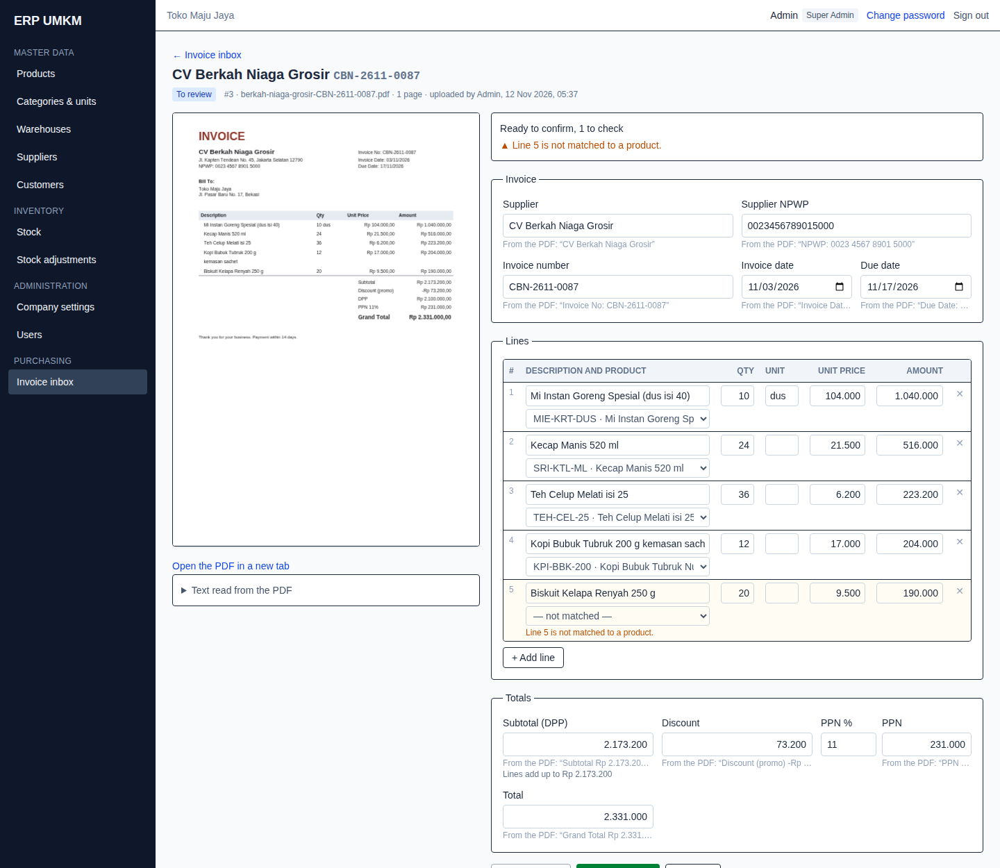
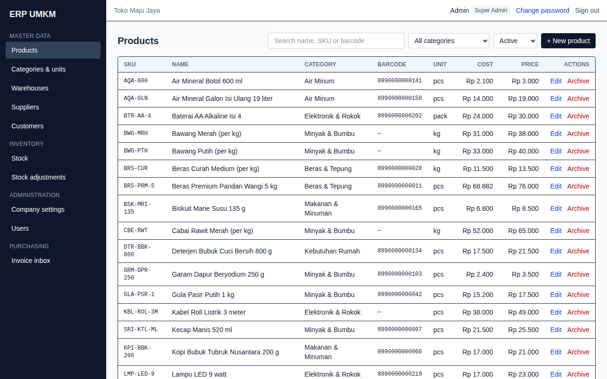
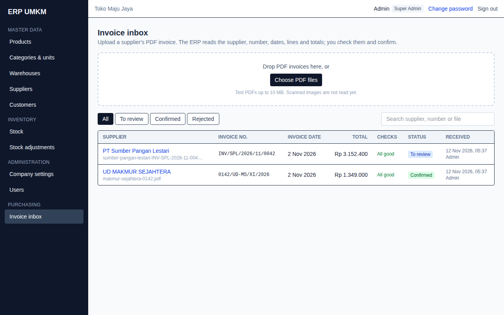
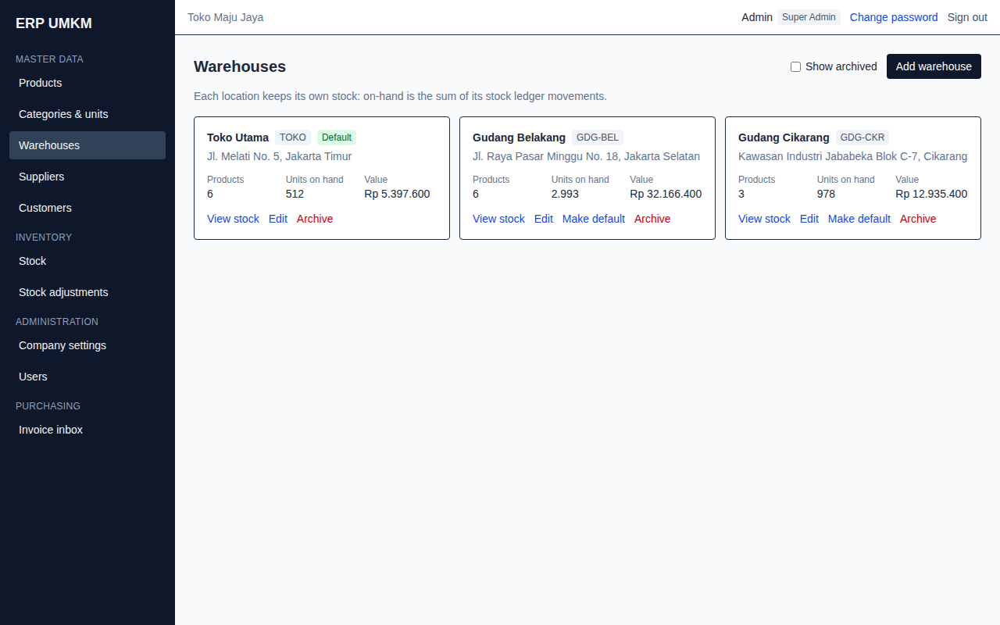
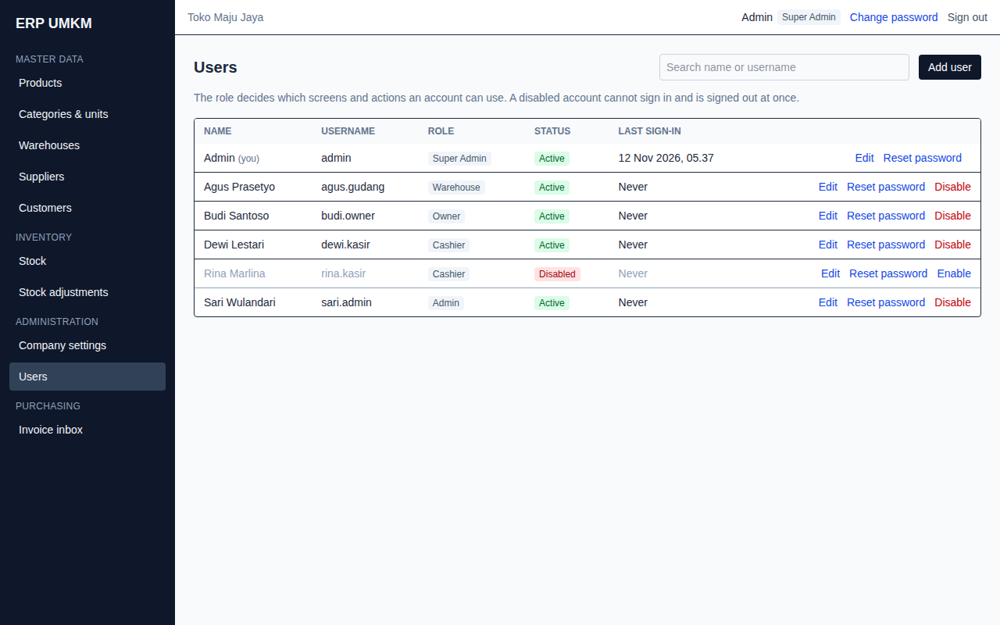
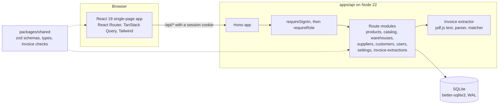
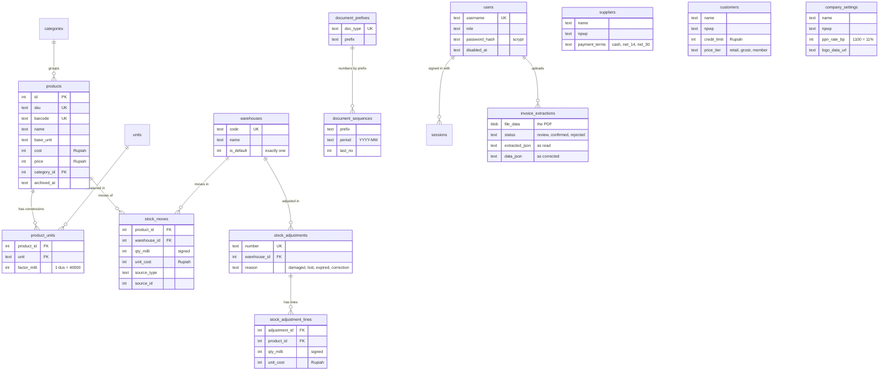
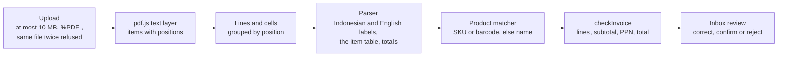
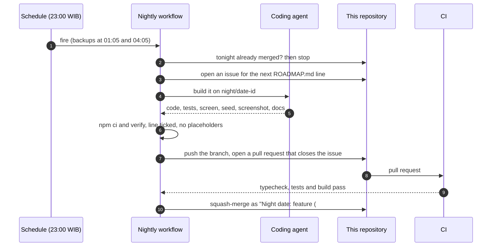
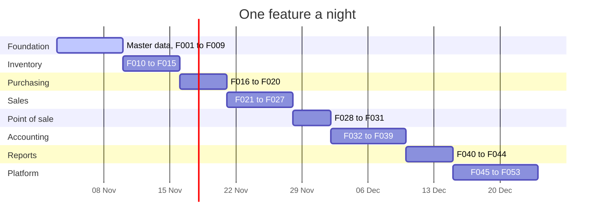

# ERP

[](https://github.com/singgihsaputro/erp/actions/workflows/ci.yml)

An ERP for Indonesian retail and distribution SMEs (UMKM): products and stock across
warehouses, purchasing, sales and invoicing with PPN, a point of sale, and the
accounting underneath. It is built one feature a night by a scheduled agent, in
the order of [ROADMAP.md](ROADMAP.md); [CHANGELOG.md](CHANGELOG.md) says what
each night added. Each feature arrives as an issue and a pull request that closes
it, merged once CI passes.



**Contents:** [Modules](#modules) · [How to run](#how-to-run) ·
[Tech stack](#tech-stack) · [Architecture](#architecture) ·
[Planning](#planning) · [Conventions](#conventions)

## Modules

- **Sign-in** — username and password, sessions, sign out, change password; roles checked on every endpoint. First start creates `admin` / `superuser` as Super Admin.
- **Products** — product catalogue: search, create, edit, archive and restore products with SKU, barcode, base unit, cost and selling price.
- **Categories & units** — product categories, units of measure, and per-product conversions to the base unit (1 dus = 40 pcs, 1 karung = 25 kg).
- **Warehouses** — several stock locations (one default), each with its own on-hand quantity and value from the stock ledger; archive and restore.
- **Stock adjustments** — post damaged, lost, expired or correction adjustments (numbered, immutable, several products at once) to the ledger; list and view them.
- **Stock** — on-hand per product per warehouse, enter opening balances (once per product and warehouse), and each product's full movement history with running balance and moving-average cost.
- **Suppliers** — supplier directory with contact person, address, NPWP and payment terms (cash, net 14, net 30); search, archive and restore.
- **Customers** — customer directory with NPWP, credit limit, payment terms and a price tier (retail, grosir, member); search, filter, archive and restore.
- **Company settings** — company name, address, NPWP, logo, PPN rate (default 11%) and the prefix of every document number series; shown in the header.
- **Users** — the super admin creates owner, admin, cashier and warehouse accounts, edits roles, resets passwords and disables or re-enables accounts.
- **Invoice inbox** — upload a supplier's PDF invoice; the ERP reads the supplier, NPWP, number, dates, lines and totals, matches the lines to products and checks the arithmetic, then you correct, confirm or reject it.

| | |
|---|---|
|  |  |
|  |  |

## How to run

Needs Node 22.

```bash
npm ci
npm run seed
npm run dev
```

The app is on http://localhost:5173 and the API on http://localhost:3001.
Sign in as **`admin`** with password **`superuser`** (Super Admin), and change
the password from the header once you are in.

The seed also creates one account per role, so you can see what each one may do:

| Username | Password | Role |
|---|---|---|
| `admin` | `superuser` | Super Admin |
| `budi.owner` | `demo-12345` | Owner |
| `sari.admin` | `demo-12345` | Admin |
| `dewi.kasir` | `demo-12345` | Cashier |
| `agus.gudang` | `demo-12345` | Warehouse |
| `rina.kasir` | `demo-12345` | Cashier, disabled — shows what a disabled account looks like |

Sample supplier invoices to upload are in `mock/invoices/` (`npm run samples`
regenerates them).

| Script | Does |
|---|---|
| `npm run dev` | API on :3001 and web on :5173 together; the web dev server proxies `/api` |
| `npm run seed` | resets the local database (`apps/api/data/erp.db`) and loads the demo data |
| `npm run verify` | typecheck, then every test, then the production build — what CI and the nightly job check |
| `npm test` / `npm run typecheck` / `npm run build` | each step on its own |
| `npm run samples` | rewrites the sample supplier PDFs in `mock/invoices/` |
| `npm run screenshots` | signs in and walks every screen in Chrome, saving `docs/screenshots/` (needs `npm run dev` on a fresh seed) |

All data is demo data. Nothing here talks to a real payment gateway, tax system
or marketplace; those sit behind interfaces with mock implementations.

## Tech stack

TypeScript everywhere, one language from the database queries to the screens, in
one npm-workspaces repository.

| Layer | Choice | Why |
|---|---|---|
| Runtime | **Node.js 22** | One runtime for the API, the build tools and the scripts. |
| API | **[Hono](https://hono.dev) 4** on `@hono/node-server` | A small, typed web framework; `app.request()` lets tests call the whole app without a network. |
| Validation | **zod 3** in `packages/shared` | One schema per input, used by the API to reject bad requests and by the screens for the same rules and types. |
| Database | **SQLite** through **better-sqlite3 11** | A single file, zero setup, synchronous and fast; WAL mode and foreign keys on. Plain SQL migrations. |
| Web | **React 19**, **Vite 6**, **React Router 7** | A single-page admin app with fast dev reloads. |
| Data fetching | **TanStack Query 5** | Caching, loading and error states, and refetching after a change, without hand-written state. |
| Styling | **Tailwind CSS 4** | Utility classes, no separate stylesheet per screen; layouts that work on a phone. |
| PDF | **pdf.js 4** (read and draw), **pdf-lib 1** (write the demo invoices) | Reads a PDF's text layer with positions on the server, and draws pages in the browser on every device. |
| Auth | **Node `crypto`** (scrypt, random tokens) | Password hashing and sessions with no extra dependency. |
| Tests | **Vitest 2**, **playwright-core** with Chrome | Fast unit and API tests; a scripted walk through the real app for screenshots. |
| Build | **esbuild** (API), **Vite** (web), **tsc** (types) | Quick builds; the type check runs separately and blocks a merge. |
| CI | **GitHub Actions** | `npm ci && npm run verify` on every pull request and on `main`. |

## Architecture

### Overview



In development Vite serves the web app on :5173 and proxies `/api` to the API on
:3001, so the browser sees one origin and the session cookie just works.

### Repository layout

```
apps/
  api/
    migrations/          001_products.sql … one numbered SQL file per change, applied in order on boot
    src/
      app.ts             builds the Hono app: open routes, the sign-in guard, then every module
      server.ts          listens on PORT (3001)
      db.ts              opens SQLite and applies pending migrations
      http.ts            HttpError, zod parsing, the shared error shape
      auth.ts            passwords, sessions, sign-in routes, requireSignIn and requireRole
      products.ts, catalog.ts, warehouses.ts, suppliers.ts, customers.ts, users.ts, settings.ts
      invoices/          pdf-text.ts, parse.ts, numbers.ts, match.ts, routes.ts, samples.ts
      seed.ts, seed-data.ts
    test/                one Vitest file per module, plus helpers.ts (signIn)
  web/
    src/
      App.tsx            sign-in gate, sidebar (filtered by role), routes
      lib/               api client, number and date formatting
      modules/           one folder per module: auth, products, catalog, warehouses,
                         suppliers, customers, users, invoices
packages/
  shared/src/            zod schemas and types for every module, money formatting, invoice checks
mock/invoices/           sample supplier PDFs
docs/screenshots/        one picture per feature
scripts/screenshots.mjs  the scripted walk through the app
```

### How a request is handled

1. The browser calls `/api/...`; the session cookie (`erp_session`, HttpOnly) goes with it.
2. `requireSignIn` looks the token up — only its SHA-256 hash is stored — and puts
   the user on the request, or answers **401**.
3. A module that is restricted adds `requireRole(...)`, answering **403** otherwise.
4. The handler parses its input with the module's zod schema from `packages/shared`
   (**400** with field errors when it fails) and runs prepared SQL statements through
   better-sqlite3, inside a transaction when several rows change together.
5. Business-rule failures throw `HttpError`: **404** missing, **409** conflicts such as
   a duplicate SKU or an already-confirmed invoice, **413/415/422** for uploads.
   Every error has the same JSON shape: `{ "error": "...", "details": ... }`.
6. On the web side, `api()` turns that into an `ApiError` the screen shows next to
   the field or above the form; a 401 anywhere drops back to the sign-in screen.

### Data model



Rules every table follows (the full list is in [CLAUDE.md](CLAUDE.md)):

- **Money is a whole number of Rupiah** — no floats, no cents.
- **Quantities are thousandths of the base unit** (`qty_milli`): 1.5 kg of rice is `1500`.
- **Stock is a ledger.** Every change is a row in `stock_moves`; on-hand is their sum,
  never a number updated in place. Costing is moving average.
- **Posted documents are immutable** and corrected by a reversing document.
- **Document numbers** look like `INV/2026/11/0007`, sequential per prefix per month.
- **PPN** comes from company settings (default 11%); prices are stored without it.
- **Migrations are append-only**: a shipped migration is never edited.

### Security

- Passwords are salted **scrypt** hashes; nothing stores or logs a password.
- Sessions are random 256-bit tokens in an **HttpOnly, SameSite=Lax** cookie (Secure
  over HTTPS), valid for 7 days; the database keeps only their hash, so a copy of it
  cannot be used to sign in.
- **Five wrong passwords lock a username for 15 minutes.** A wrong username and a wrong
  password get the same answer, in the same time.
- Changing a password signs that user out everywhere else; disabling a user ends their
  sessions at once.
- Every endpoint except `/api/health` and `/api/auth/*` needs a session. Roles today:

| | Super Admin | Owner | Admin | Cashier | Warehouse |
|---|:-:|:-:|:-:|:-:|:-:|
| Products, categories and units | ✓ | ✓ | ✓ | ✓ | ✓ |
| View warehouses, suppliers, customers | ✓ | ✓ | ✓ | ✓ | ✓ |
| Manage warehouses, suppliers, customers | ✓ | ✓ | ✓ | | |
| Invoice inbox | ✓ | ✓ | ✓ | | |
| Company settings: view | ✓ | ✓ | ✓ | ✓ | ✓ |
| Company settings: change | ✓ | ✓ | ✓ | | |
| Users | ✓ | | | | |

### Reading a PDF invoice



The extractor is deliberately rule-based: it runs offline, costs nothing per page,
and every value comes with the PDF text it was read from, so a person can check it.
It knows Indonesian and English labels (*No. Faktur*, *Invoice No*, *Jatuh Tempo*,
*DPP*, *PPN 11%*, *Grand Total*), both number formats (`Rp 1.250.000,00` and
`1,250,000.00`), dates such as *2 November 2026* or *03/11/2026*, and terms such as
*30 hari*. The same `checkInvoice` runs live on the review screen and again on the
server before an invoice can be confirmed. Scanned PDFs, which have no text layer,
are refused with a clear message until on-device OCR arrives (see the roadmap).

### Front end

- **One folder per module** under `apps/web/src/modules`, each with its page, forms and
  dialogs; the sidebar shows only what the signed-in role may use.
- **TanStack Query** owns server state: each list and record has a query key, and a
  change invalidates the keys it affects.
- **Forms keep what the person typed as text** and convert on every change, so
  `1.250.000` and `12,5` stay as typed while the shared checks run on real numbers.
- **pdf.js is loaded only when an invoice is opened**, keeping the main bundle small,
  and draws pages itself so the preview also works on Android.
- Desktop-first admin layout that stays usable on a phone; tables paginate past 50 rows;
  destructive actions confirm first.

### Testing and quality

- **Vitest in every workspace.** API tests build the real app on a fresh in-memory
  SQLite database per test and call it with `app.request()`; `signIn()` returns a client
  that carries the session cookie.
- Each feature tests the happy path, the validation errors, the 401 and 403, and the
  business rule that matters most (a duplicate NPWP, a unit still in use, confirming an
  invoice whose numbers do not add up).
- **The invoice extractor is tested on real PDFs** in three different layouts, generated
  by the same code as the demo files, plus hand-built edge cases.
- **`scripts/screenshots.mjs`** signs in and walks every screen in Chrome; a step that
  cannot find what it expects fails the run.
- **CI** runs `npm ci && npm run verify` on every pull request and on `main`; nothing
  merges red.

### Decisions

| Decision | Why | Revisit when |
|---|---|---|
| SQLite, one file | No server to run; plenty for one shop or a few branches | Many concurrent writers or several servers — the SQL is plain and moves to Postgres |
| Synchronous better-sqlite3 | Simple transactions, no async plumbing for queries | Never needed so far |
| Shared zod schemas | One definition of every input for the API, the forms and the types | — |
| Integers for money and quantities | No rounding drift in Rupiah or in 1.5 kg | — |
| A stock ledger, not a stock column | Every number can be traced to the document that caused it | — |
| Cookie sessions, not JWTs | Signing out and disabling a user take effect at once | A separate mobile app needs tokens |
| PPN rate in basis points, logo as a data URL | Keeps the rate an integer and the logo in the same database file, no upload storage | Logos get large or many files are needed |
| Rule-based invoice extraction | Offline, free, explainable, testable | Layouts it cannot read become common |
| Mock integrations behind interfaces | Builds and tests need no keys or network | A real payment, e-Faktur or marketplace integration is wanted |

## Planning

### How work is planned and delivered

[ROADMAP.md](ROADMAP.md) is the plan: one line per feature, in the order they are
built, each saying what a user can do when it ships. Reordering or adding lines
changes the plan; the nightly run reads it fresh every time.

Every feature must meet the same definition of done: validated API endpoints, API
tests, a real screen with loading, empty and error states, demo data, a screenshot,
and the roadmap, changelog and this README updated.



A night whose CI fails leaves its pull request open, and the next fire that night
retries on the same issue and pull request. The workflow lives in
[`singgihsaputro/daily-projects`](https://github.com/singgihsaputro/daily-projects/blob/main/.github/workflows/erp-nightly.yml).

### Phases

| Phase | Features | What it delivers |
|---|---|---|
| Foundation and master data | F001–F009 | Products, sign-in, the invoice inbox, categories and units, warehouses, suppliers, customers, users, company settings |
| Inventory | F010–F015 | Opening stock and the stock ledger, adjustments, transfers, reorder points, stock opname, batches and expiry |
| Purchasing | F016–F020 | Purchase orders, goods receipt, supplier invoices (including from the invoice inbox), payments, returns |
| Sales | F021–F027 | Quotations and sales orders, Surat Jalan, sales invoices with PPN, payments, returns, price lists, promotions |
| Point of sale | F028–F031 | Checkout and receipts, cashier shifts, payment methods, hold and recall |
| Accounting | F032–F039 | Chart of accounts, automatic and manual journals, cash and bank, ledger and trial balance, P&L, balance sheet, PPN report |
| Reports and dashboard | F040–F044 | Dashboard, sales, inventory valuation, purchases, gross margin |
| Platform | F045–F053 | Audit log, CSV import, Bahasa Indonesia, print templates, backup, branches, approvals, scanned invoices, notifications |

### Timeline

Target dates at one feature a night, as planned on 8 November 2026; a night that
does not merge moves everything after it by a day. What has actually shipped is in
[ROADMAP.md](ROADMAP.md) and [CHANGELOG.md](CHANGELOG.md).



### After the roadmap

Not scheduled yet, and the likely next lines once the roadmap is through:

- **Deployment.** Today it runs locally. The next step is the API serving the built web
  app from one process, with the database on a persistent disk.
- **Real integrations** behind the existing interfaces: e-Faktur, QRIS payments,
  marketplace orders.
- **Postgres** if several branches write at once from separate servers.

## Conventions

Everything a feature must follow — the data rules, sign-in and roles, testing, the
screenshot, what to record — is in [CLAUDE.md](CLAUDE.md), which the nightly agent
reads before every feature. Issues and pull requests are welcome.
